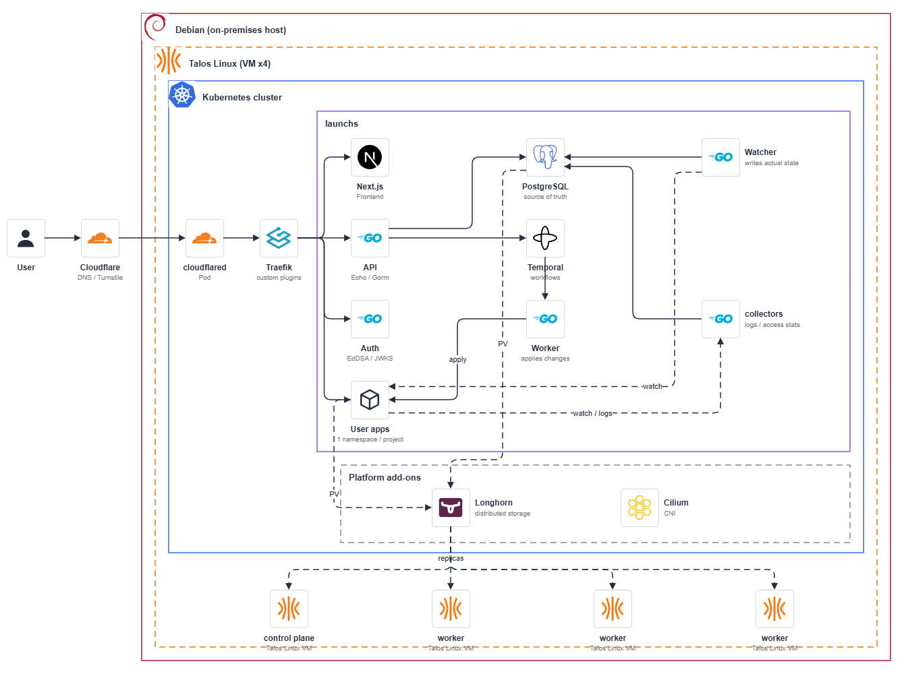

# mattuu0

```
$ whoami
mattuu0

$ cat role.txt
Backend / Infrastructure

$ now
launchs を開発中 (Kubernetes 上のデプロイ基盤)
```

バックエンドとインフラをやっています。
気になった OSS は自分のサーバーに入れて動かしてみる、というのをよくやります。

<br>

<h2 align="center">Portfolio</h2>
<h1 align="center"><a href="https://mattuu.com">mattuu.com</a></h1>

<h2 align="center">Contact</h2>
<h3 align="center">Mail &nbsp;<a href="mailto:contact@mattuu.com">contact@mattuu.com</a></h3>
<h3 align="center">X &nbsp;<a href="https://x.com/Mattuu55527453">@Mattuu55527453</a></h3>
<h3 align="center">GitHub &nbsp;<a href="https://github.com/mattuu0">@mattuu0</a></h3>

<br>

## いま作っているもの

### launchs

Kubernetes の上でコンテナをデプロイ・公開できる、Railway みたいなサービスを作っています。
プロジェクトごとに namespace を分けて、設定の変更はいったん保留にしてから確認して反映する作りです。

リポジトリは [launchs-org](https://github.com/launchs-org) にまとめていて、本体は [v2](https://github.com/launchs-org/v2) です。

| | |
|---|---|
| バックエンド | Go (Echo, Gorm) |
| ワークフロー | Temporal |
| フロントエンド | Next.js, TypeScript |
| DB | PostgreSQL |
| Ingress | Traefik (プラグインを自作) |
| ビルド | railpack, BuildKit |
| CI | GitHub Actions, GHCR |

構成



API は変更を DB に保存するだけで、実際の反映は Temporal 経由で Worker がやります。
DB に実際の状態を書き込むのは Watcher だけにして、状態がずれないようにしています。

## 技術スタック


| | |
|---|---|
| 言語 | Go, Python, Node.js, Rust, HTML / CSS / JavaScript |
| DB | PostgreSQL, MySQL |
| インフラ | Docker, Kubernetes, Talos Linux, Debian, Cloudflare, Terraform |
| ツール | Task, VS Code, Claude Code, Git / GitHub |

一番よく書くのは Go で、次が Python と Node.js です。Rust と DB はまだ勉強中です。

## 作ったもの

| 名前 | 内容 | 技術 |
|---|---|---|
| [Meecha](https://github.com/mattuu0/new_meecha) | 設定した範囲内にフレンドがいると通知が来る位置情報アプリ | Go, PostgreSQL, Redis, Kubernetes |
| [Makeck](https://makeck.mattuu.com/app/) | 料理の手順書を作ってくれるアプリ | Go, MySQL, Docker |
| [Rihlar](https://github.com/Rihlar) | 歩いた場所が自分の陣地になる陣取りゲーム | Go, MySQL, Kubernetes |

## 連絡先

- ポートフォリオ: [mattuu.com](https://mattuu.com)
- メール: [contact@mattuu.com](mailto:contact@mattuu.com)
- X: [@Mattuu55527453](https://x.com/Mattuu55527453)
